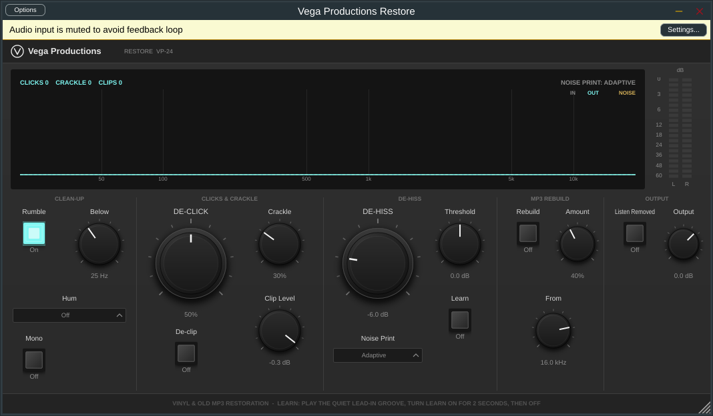

# Vega Productions Restore (VP-24)

Restoration for vinyl rips and old MP3s: removes clicks, crackle, hiss, rumble and hum, rebuilds clipped peaks, and brings back the top end that low-bitrate MP3s cut off.



## Download
- **Windows (FL Studio):** https://github.com/DJVega70/vega-restore/releases/latest/download/VegaProductions-Restore-Windows-VST3.zip
- **macOS:** https://github.com/DJVega70/vega-restore/releases/latest/download/VegaProductions-Restore-macOS-VST3-AU.zip

## Modules (in signal order)
- **Clean-up**
  - **Rumble** removes turntable rumble and warp wobble below the set frequency (24 dB/oct).
  - **Hum** notches out 50 or 60 Hz mains hum and its harmonics.
  - **Mono** is for mono records played with a stereo cartridge. It cancels the vertical-groove noise that a stereo cartridge picks up.
- **Clicks & crackle**
  - **De-click** handles pops and ticks. **Crackle** handles the dense small ticks of surface noise.
  - Damage is found with a linear-prediction model of the music. It is rebuilt with least-squares AR interpolation, the method used in professional restoration tools, so the gap is filled with audio that continues the music instead of being muted or smoothed over.
  - Drum hits and other real transients are recognised and left alone.
- **De-clip** rebuilds the flattened peaks of clipped MP3s and masters. Lower **Output** afterwards, because the rebuilt peaks go above 0 dBFS.
- **De-hiss** is spectral noise reduction with a smoothed gain curve to avoid "musical noise".
  - **Adaptive** follows the noise floor by itself and ignores held notes.
  - **Learned** uses a noise print. Play the quiet lead-in groove or a silent gap, switch **Learn** on for about 2 seconds, then switch it off. The print is saved with your project.
  - **Threshold** sets how far above the noise a sound must be to be kept.
- **MP3 Rebuild** regenerates the missing octave above **From**. Set it to where the MP3's spectrum stops, usually 15–16 kHz for 128 kbps files and 11–13 kHz for older ones.
- **Listen Removed** plays only what is being taken out, so you can check that no music is being removed.

The display shows the input (grey), the output (blue), the noise estimate (gold), and running counts of repaired clicks, crackle and clips. Double-click the display to reset the counts.

Latency is 3072 samples (64 ms at 48 kHz) and is reported to the host. Restore is meant for cleaning files, not for live monitoring.

## Building
```
cmake -B build -DVEGA_TESTS=ON
cmake --build build --config Release --target VegaRestore_VST3 VegaRestoreTest
```
The self-test checks:
- transparency when everything is off;
- click and crackle removal against the clean original;
- that drum hits are left alone;
- de-hiss with both the adaptive and learned modes, including saving and recalling the print;
- hum and rumble removal;
- de-clip accuracy;
- MP3 rebuild;
- stability.
